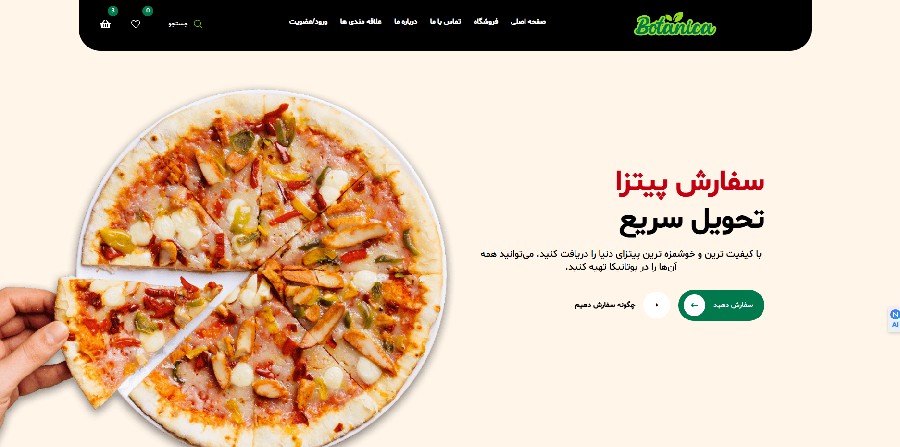

# 🚀 User Management Dashboard

<div align="center">

# Next.js + Tailwind CSS + MongoDB

A modern full-stack dashboard with **User Panel** and **Admin Panel**, built using the latest web technologies.




</div>

---

## 📸 Preview

### Landing Page


### User Dashboard


### Admin Dashboard


---

## ✨ Features

### 👤 User Panel

- Secure Authentication (JWT)
- User Profile Management
- Change Password
- Personal Dashboard
- Account Settings
- Responsive UI
- Dark Mode Support

### 🛡️ Admin Panel

- User Management
- Role-Based Access Control (RBAC)
- Dashboard Analytics
- Content Management
- Search & Filtering
- Activity Monitoring
- Admin Settings

---

## 🏗 Tech Stack

| Category | Technology |
|-----------|------------|
| Frontend | Next.js, React |
| Styling | Tailwind CSS |
| Backend | Next.js API Routes |
| Database | MongoDB |
| ODM | Mongoose |
| Authentication | JWT |
| Deployment | Vercel / VPS |

---

## 📂 Project Structure

```bash
src/
├── app/
│   ├── dashboard/
│   ├── admin/
│   ├── login/
│   └── register/
│
├── components/
│   ├── ui/
│   ├── layout/
│   └── dashboard/
│
├── lib/
│   ├── mongodb.ts
│   ├── auth.ts
│   └── helpers.ts
│
├── models/
│   └── User.ts
│
├── middleware.ts
└── public/
```

---

## 🔐 Authentication & Authorization

```text
Guest
 ├─ Register
 └─ Login

User
 ├─ Dashboard
 ├─ Profile
 └─ Settings

Admin
 ├─ Users Management
 ├─ Analytics
 ├─ Content Management
 └─ System Settings
```

---

## ⚙️ Environment Variables

Create a `.env.local` file:

```env
MONGODB_URI=your_mongodb_connection_string
JWT_SECRET=your_secret_key
NEXT_PUBLIC_APP_URL=http://localhost:3000
```

---

## 🚀 Getting Started

### Clone Repository

```bash
git clone https://github.com/yourusername/project-name.git
```

### Install Dependencies

```bash
npm install
```

### Run Development Server

```bash
npm run dev
```

Open:

```bash
http://localhost:3000
```

---

## 📈 Future Improvements

- Email Verification
- Two-Factor Authentication
- Notifications System
- Audit Logs
- Multi-language Support
- Advanced Analytics

---

## 🌟 Why This Project?

This project demonstrates:

- Full-Stack Development
- Authentication & Authorization
- MongoDB Integration
- Scalable Folder Structure
- Modern UI/UX Design
- Production-Ready Architecture

---

## 🤝 Contributing

Pull requests are welcome. For major changes, please open an issue first to discuss what you would like to change.

---

## 📄 License

MIT License

---

<div align="center">

### ⭐ If you like this project, give it a star on GitHub!

Made with ❤️ using Next.js & MongoDB

</div>
