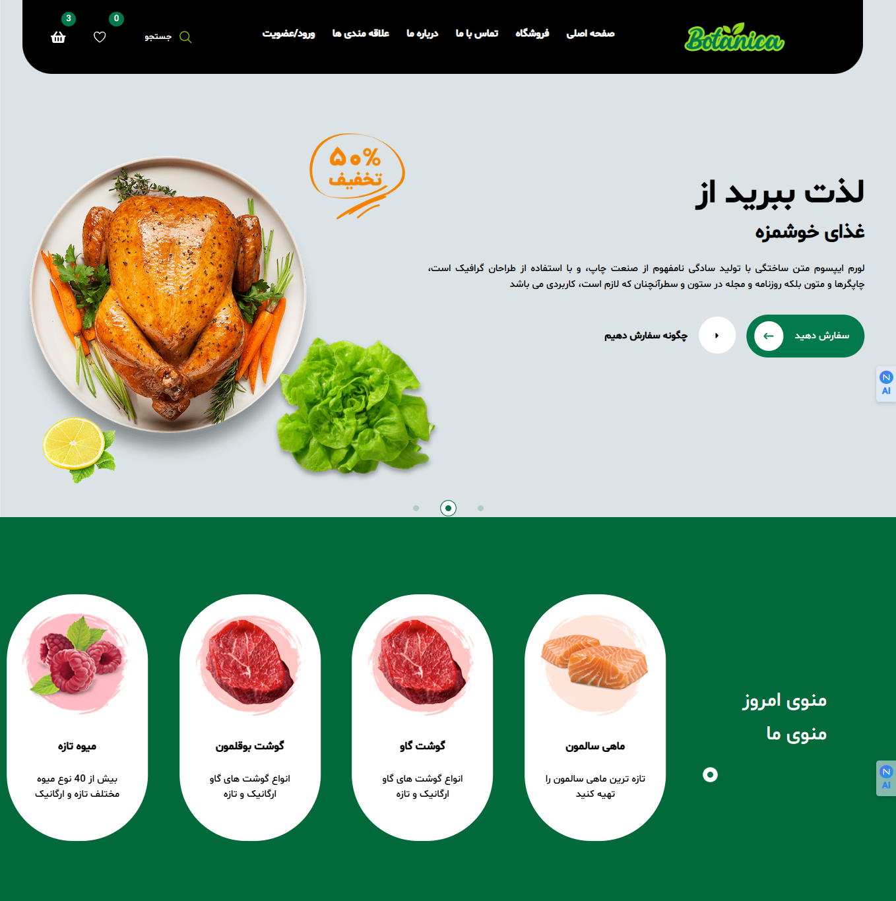
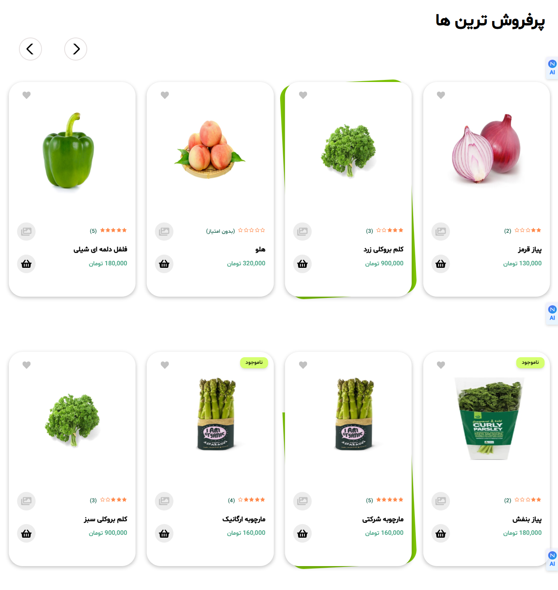
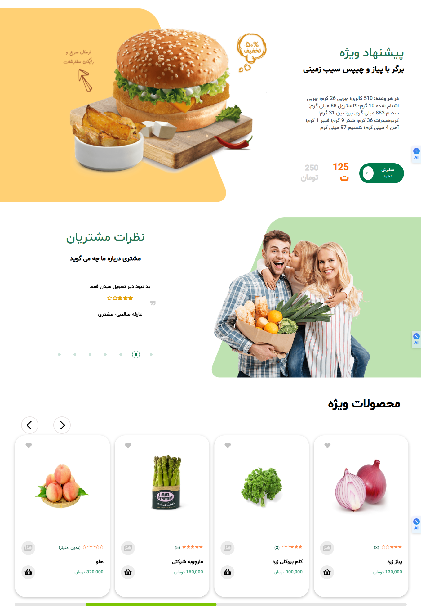
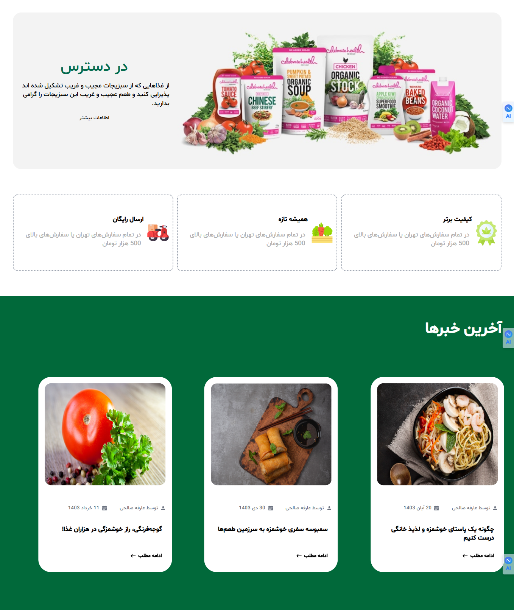
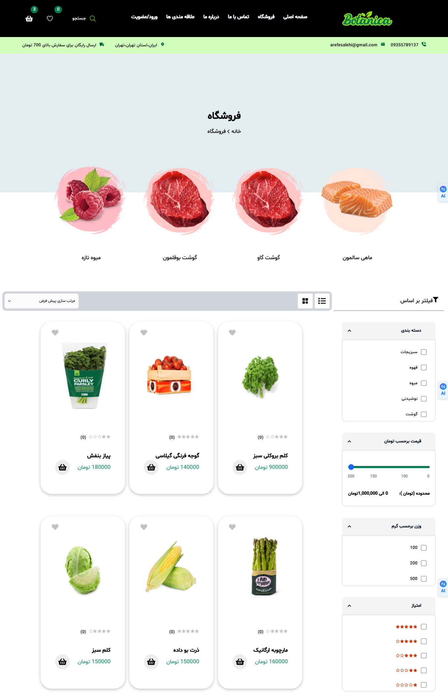
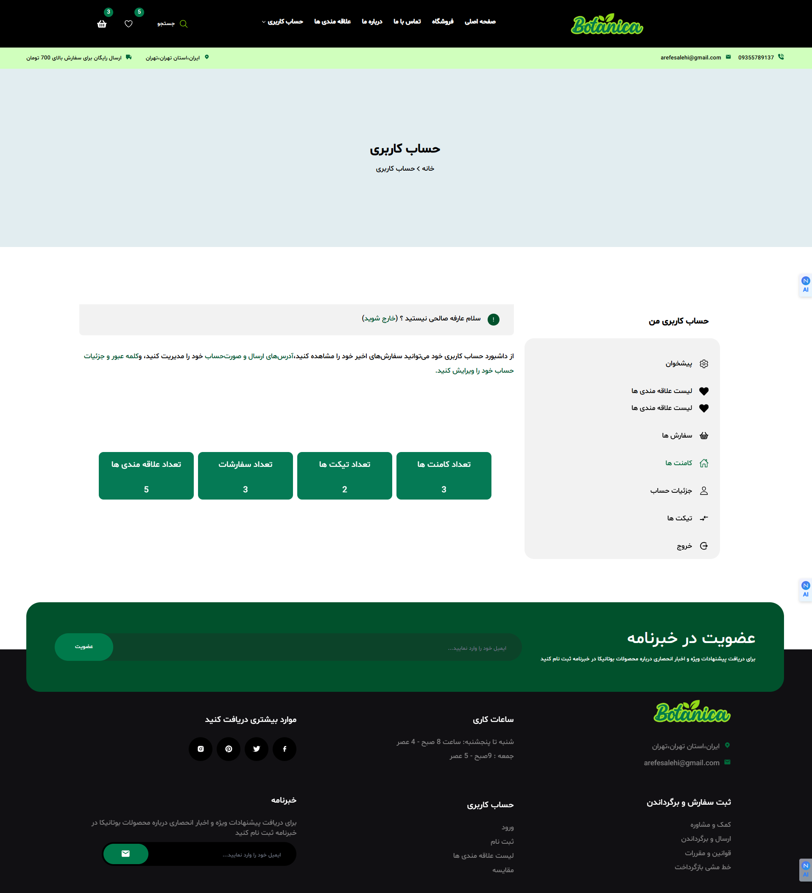
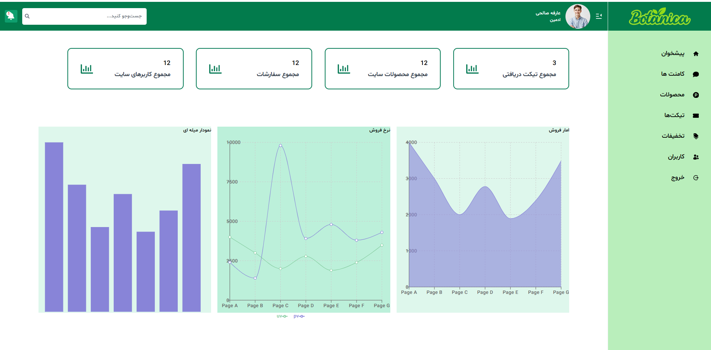

# 🚀 # 🛒 FreshCart | Modern Food & Beverage E-Commerce Platform

<div align="center">

## Next.js + Tailwind CSS + MongoDB

A modern and scalable full-stack **Food & Beverage E-Commerce Platform** built with Next.js, MongoDB, and Tailwind CSS, featuring a seamless shopping experience for users and a powerful admin dashboard for management.


</div>

---

## 📸 Live Preview

> 📌 Replace images with real screenshots or GIF demo for best impact

### 🏠 Landing Page










### 👤 User Dashboard


### 🛡️ Admin Dashboard


---

## ✨ Key Features

### 👤 User Panel
- Secure Authentication (JWT-based)
- User Profile Management
- Edit personal information
- Password change functionality
- Responsive UI (Mobile-first)
- Dark / Light mode support

### 🛡️ Admin Panel
- Role-Based Access Control (RBAC)
- User management (Create / Edit / Delete)
- System analytics dashboard
- Search & filtering system
- Activity monitoring
- Admin settings panel

---

## 🏗 Tech Stack

| Layer | Technology |
|------|------------|
| Frontend | Next.js (App Router), React |
| Styling | Tailwind CSS |
| Backend | Next.js API Routes |
| Database | MongoDB + Mongoose |
| Auth | JWT Authentication |
| Deployment | Vercel / VPS |

---

## 📂 Project Architecture

```bash
src/
├── app/
│   ├── (auth)/
│   ├── dashboard/
│   ├── admin/
│   └── api/
│
├── components/
│   ├── ui/
│   ├── layout/
│   └── shared/
│
├── lib/
│   ├── db.ts
│   ├── auth.ts
│   └── utils.ts
│
├── models/
│   └── User.model.ts
│
├── middleware.ts
└── public/
